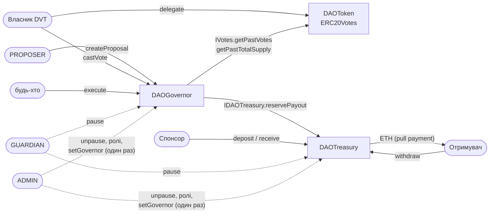
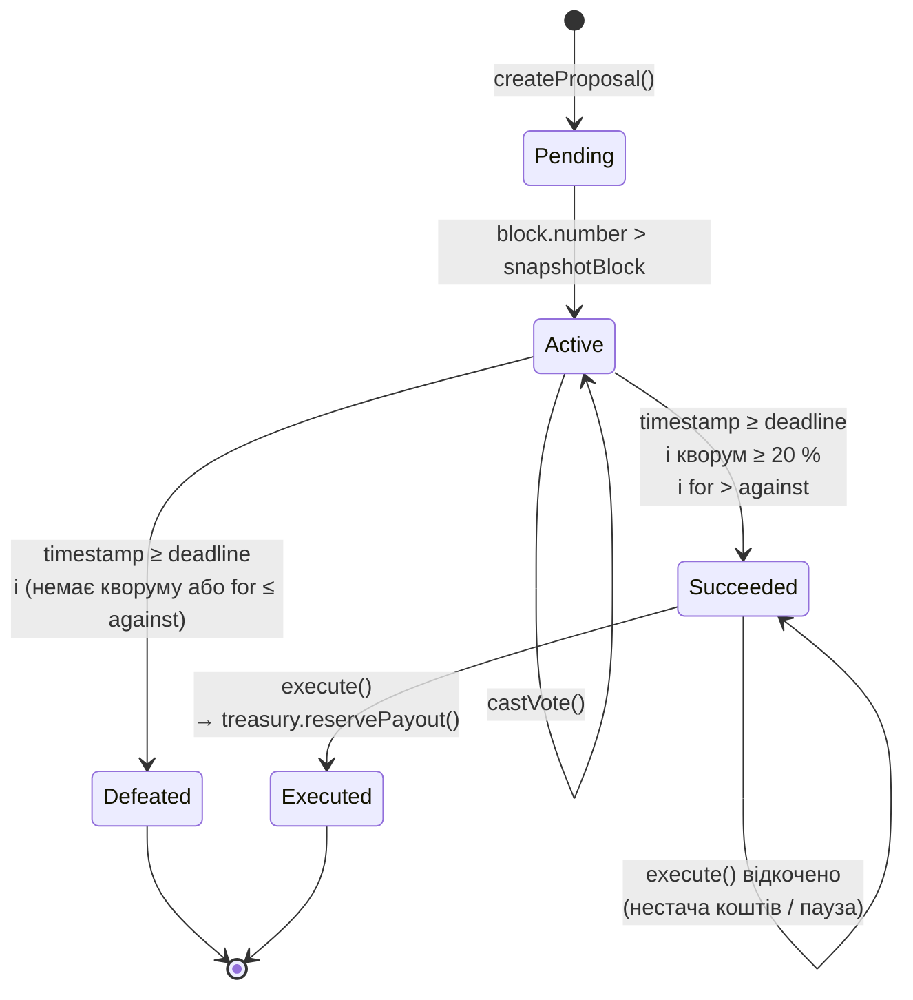

# Вимоги та проєктування — сценарій D «Голосування в DAO»

## 1. Склад системи

| Контракт | Призначення | Стандарт / бібліотеки |
|---|---|---|
| `DAOToken` | Токен голосу DVT, фіксований випуск 1000 DVT, історичні знімки голосів (checkpoints) | ERC-20 + `ERC20Votes` (OpenZeppelin 5.4.0) |
| `DAOGovernor` | Пропозиції, голосування за знімком, кворум 20 %, дедлайн, виконання рішення | `AccessControl`, `Pausable`, `ReentrancyGuard` |
| `DAOTreasury` | Зберігання ETH, резервування ухвалених виплат, отримання коштів самим отримувачем (`withdraw`) | `AccessControl`, `Pausable`, `ReentrancyGuard` |

Взаємодія через інтерфейси:
- `DAOGovernor` → `IVotes` (OpenZeppelin) для `getPastVotes` / `getPastTotalSupply`;
- `DAOGovernor` → `IDAOTreasury` для `reservePayout` / `availableBalance`.

## 2. Ролі

| Роль | Де | Що може |
|---|---|---|
| **ADMIN** (`DEFAULT_ADMIN_ROLE`) | Governor, Treasury | Видавати й відкликати ролі; знімати паузу (`unpause`); один раз прив'язати скарбницю до Governor (`setGovernor`) |
| **PROPOSER** (`PROPOSER_ROLE`) | Governor | Створювати пропозиції про виплату |
| **GUARDIAN** (`GUARDIAN_ROLE`) | Governor, Treasury | Вмикати аварійну паузу (`pause`), але не знімати її |
| **Governor** (адреса контракту) | Treasury | Єдиний, хто може викликати `reservePayout` (модифікатор `onlyGovernor`) |
| Власник токенів (голосуючий) | Token, Governor | Делегувати голоси, голосувати силою голосу на момент знімка |
| Отримувач | Treasury | Забрати зарезервовану для нього суму через `withdraw` |
| Будь-який акаунт | Governor, Treasury | Виконати ухвалену пропозицію (`execute`), поповнити скарбницю |

Розділення GUARDIAN / ADMIN навмисне: швидко зупинити систему може «охоронець», а відновити роботу — лише адміністратор.

## 3. Користувацькі сценарії

1. **Активація голосів.** Власник DVT делегує голоси собі (або іншій адресі); лише після цього баланс стає силою голосу.
2. **Створення пропозиції.** Автор (PROPOSER) пропонує виплатити *X* ETH отримувачу з описом до 512 байтів. Фіксується блок знімка і дедлайн `timestamp + votingPeriod`.
3. **Голосування.** Власник голосує «за», «проти» або «утримався» вагою, яку мав у блоці знімка. Повторно проголосувати не можна.
4. **Захист від повторного використання токенів.** Хто отримав токени або делегування після знімка, не може ними голосувати; той, хто передав токени після знімка, голосує старою вагою — тож сумарна вага не перевищує випуску.
5. **Виконання рішення.** Після дедлайну будь-хто викликає `execute` для ухваленої пропозиції; Governor резервує кошти у скарбниці на отримувача.
6. **Отримання виплати.** Отримувач окремою транзакцією забирає свої кошти (`withdraw`). Інші адреси чужі кошти забрати не можуть.
7. **Пропозиція не пройшла.** Без кворуму 20 % (рахуються «за» + «проти» + «утримались»), при нічиїй або перевазі «проти» пропозиція відхилена і не виконується.
8. **Нестача коштів.** Якщо вільних коштів скарбниці недостатньо, виконання відкочується, пропозиція лишається «Ухваленою»; після поповнення виконання можна повторити.
9. **Аварійна зупинка.** GUARDIAN ставить на паузу створення пропозицій, голосування, виконання, депозити, резервування й виплати; ADMIN знімає паузу. Пауза не продовжує дедлайн.
10. **Поповнення скарбниці.** Будь-хто надсилає ETH напряму або через `deposit()`; подія `Deposited` фіксує внесок.

## 4. Діаграма станів пропозиції (головний контракт — DAOGovernor)

Стан не зберігається окремо, а обчислюється функцією `state(id)` з блоку, часу, голосів і прапорця `executed`.

| Стан | Код | Умова |
|---|---|---|
| Pending | 0 | `block.number ≤ snapshotBlock` |
| Active | 1 | `block.number > snapshotBlock` і `block.timestamp < deadline` |
| Defeated | 2 | дедлайн настав, кворуму немає або `forVotes ≤ againstVotes` |
| Succeeded | 3 | дедлайн настав, `участь ≥ кворум` і `forVotes > againstVotes` |
| Executed | 4 | `executed == true` |

Стан виплати у скарбниці: `немає` → `зарезервовано` (`claimable[recipient] > 0`) → `отримано` (`withdraw`).

## 5. Таблиця функцій

### DAOToken

| Функція | Хто викликає | Що змінює | Події | Помилки |
|---|---|---|---|---|
| `constructor(initialHolder)` | розгортальник | випускає 1000 DVT | `Transfer` | `InvalidInitialHolder` |
| `transfer`, `transferFrom`, `approve` | власник / довірена особа | баланси, checkpoints голосів | `Transfer`, `Approval`, `DelegateVotesChanged` | `ERC20InsufficientBalance`, `ERC20InvalidReceiver`, … |
| `delegate(delegatee)` | власник токенів | делегат, checkpoints | `DelegateChanged`, `DelegateVotesChanged` | — |
| `getVotes`, `getPastVotes`, `getPastTotalSupply` | будь-хто (view) | — | — | `ERC5805FutureLookup` |

### DAOGovernor

| Функція | Хто викликає | Що змінює | Події | Помилки |
|---|---|---|---|---|
| `constructor(...)` | розгортальник | ролі, адреси, `votingPeriod` (60 с … 30 діб) | `RoleGranted` | `InvalidAddress`, `InvalidContractAddress`, `InvalidVotingPeriod` |
| `createProposal(recipient, amount, description)` | PROPOSER, не на паузі | новий запис `Proposal`, `proposalCount` | `ProposalCreated` | `AccessControlUnauthorizedAccount`, `EnforcedPause`, `InvalidAddress`, `InvalidAmount`, `InvalidDescriptionLength` |
| `castVote(id, support)` | власник голосів на момент знімка, не на паузі | лічильник голосів, `hasVoted` | `VoteCast` | `InvalidVoteType`, `UnknownProposal`, `UnexpectedProposalState`, `AlreadyVoted`, `NoVotingPower`, `EnforcedPause` |
| `execute(id)` | будь-хто, не на паузі | `executed`; резерв у скарбниці | `ProposalExecuted` (+ `PayoutReserved` скарбниці) | `UnknownProposal`, `UnexpectedProposalState`, `EnforcedPause`, помилки скарбниці |
| `state(id)`, `quorum(id)`, `getProposal(id)` | будь-хто (view) | — | — | `UnknownProposal`, `SnapshotNotReady` |
| `getProposals(offset, limit)` | будь-хто (view), сторінки до 50 записів | — | — | `InvalidPageSize` |
| `pause()` | GUARDIAN | `paused = true` | `Paused` | `AccessControlUnauthorizedAccount`, `EnforcedPause` |
| `unpause()` | ADMIN | `paused = false` | `Unpaused` | `AccessControlUnauthorizedAccount`, `ExpectedPause` |
| `grantRole`, `revokeRole` | ADMIN | ролі | `RoleGranted`, `RoleRevoked` | `AccessControlUnauthorizedAccount` |

### DAOTreasury

| Функція | Хто викликає | Що змінює | Події | Помилки |
|---|---|---|---|---|
| `constructor(admin, guardian)` | розгортальник | ролі | `RoleGranted` | `InvalidAddress` |
| `receive()`, `deposit()` | будь-хто, не на паузі | баланс ETH | `Deposited` | `ZeroAmount`, `EnforcedPause` |
| `setGovernor(governor)` | ADMIN, лише один раз | `governor` | `GovernorSet` | `GovernorAlreadySet`, `InvalidAddress`, `InvalidGovernor`, `AccessControlUnauthorizedAccount` |
| `reservePayout(id, recipient, amount)` | лише контракт Governor, не на паузі | `claimable`, `totalReserved`, `payoutReserved` | `PayoutReserved` | `UnauthorizedGovernor`, `InvalidAddress`, `ZeroAmount`, `PayoutAlreadyReserved`, `InsufficientAvailableFunds`, `EnforcedPause` |
| `withdraw()` | отримувач, не на паузі | обнуляє `claimable`, зменшує `totalReserved`, переказує ETH | `Withdrawn` | `NothingToWithdraw`, `TransferFailed`, `EnforcedPause`, `ReentrancyGuardReentrantCall` |
| `availableBalance()` | будь-хто (view) | — | — | — |
| `pause()` / `unpause()` | GUARDIAN / ADMIN | `paused` | `Paused` / `Unpaused` | `AccessControlUnauthorizedAccount`, `EnforcedPause`, `ExpectedPause` |

## 6. Ключові проєктні рішення

- **Pull payment.** Скарбниця лише резервує кошти; отримувач забирає їх сам. Отримувач, що відхиляє ETH, не блокує нікого іншого (перевірено тестом).
- **Checks → Effects → Interactions.** У `withdraw` спочатку перевірка `amount > 0`, потім обнулення `claimable` і зменшення `totalReserved`, і лише потім `call{value}`. Додатково — `nonReentrant`.
- **Жодних необмежених циклів у функціях зі зміною стану.** Єдиний цикл — у view-функції `getProposals` з обмеженням сторінки 50 записів.
- **Знімки голосів.** Вага береться з `getPastVotes(snapshotBlock)`, кворум — з `getPastTotalSupply(snapshotBlock)`, тому купівля чи передача токенів після створення пропозиції не впливає на результат.
- **Час.** Дедлайн залежить від `block.timestamp`; валідатор може зсунути його на кілька секунд, тому мінімальна тривалість голосування — 60 с, і на точність до секунди логіка не покладається.
